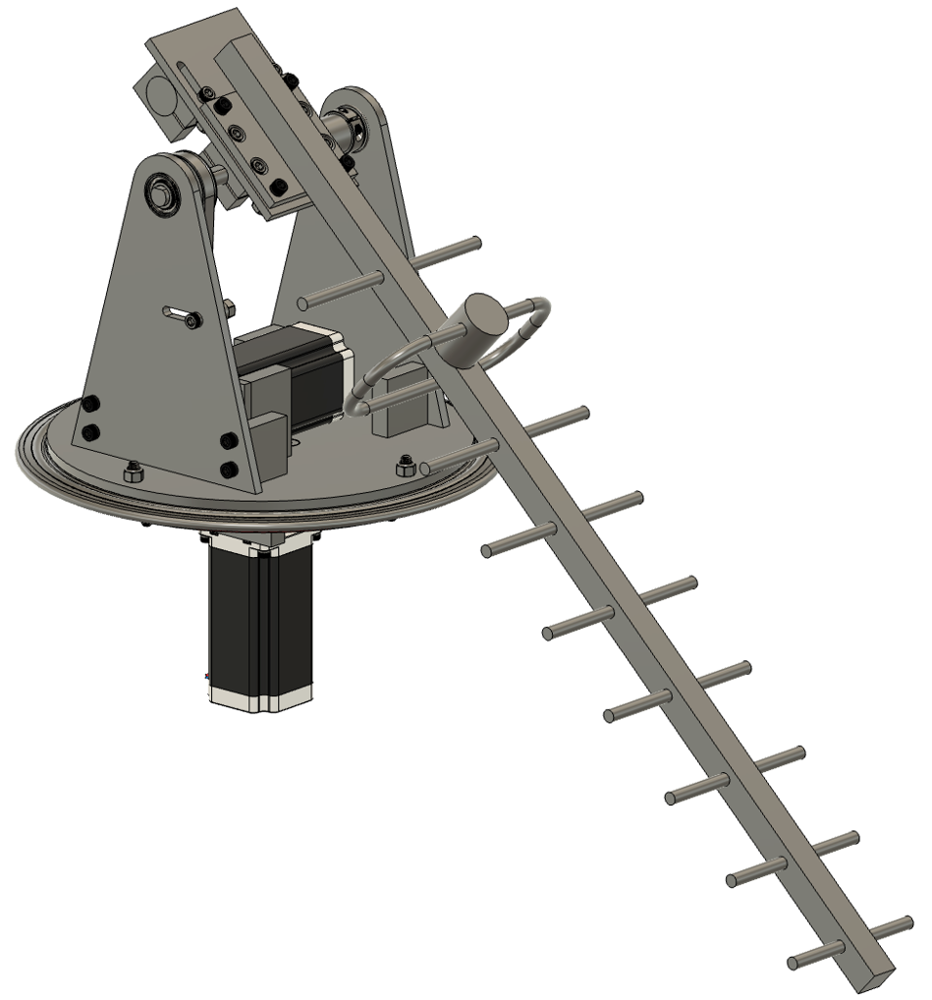
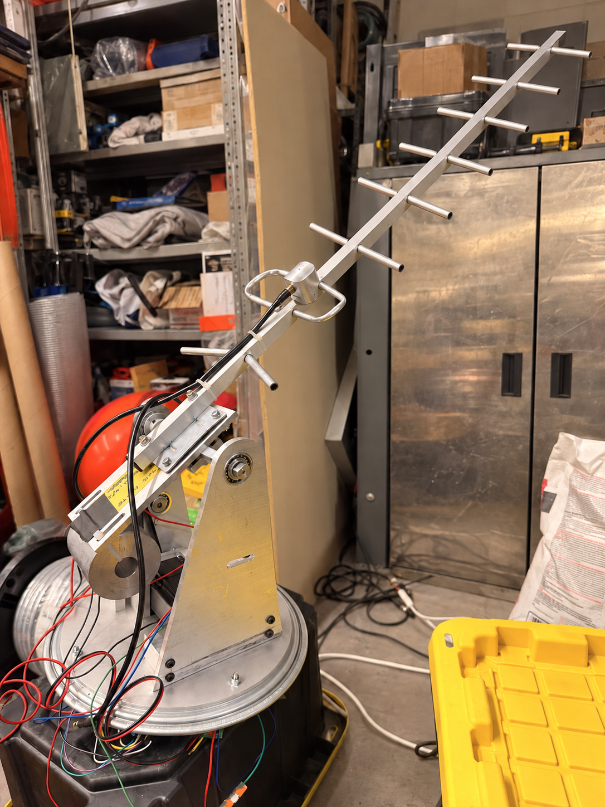
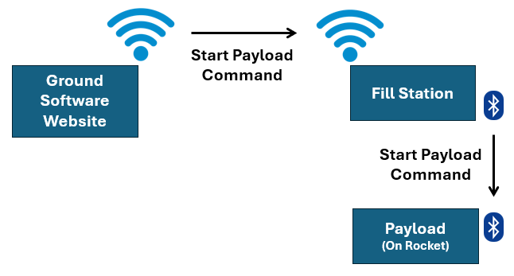
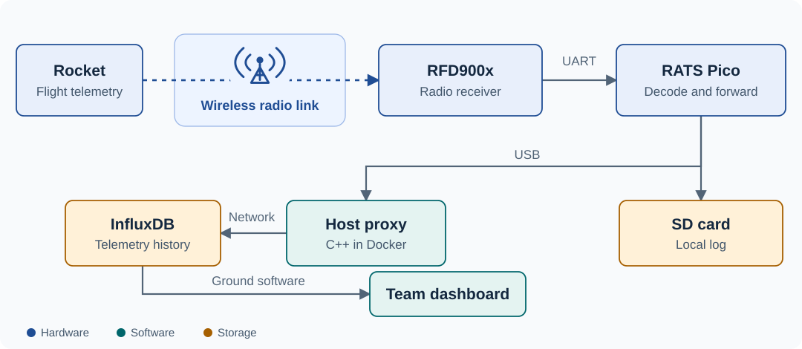
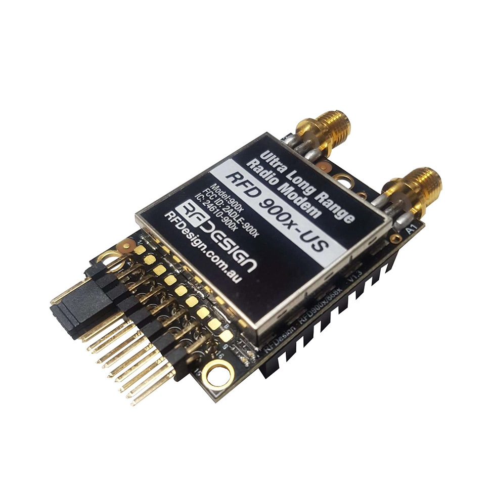

# RATS Software

The **Rotational Antenna Tracking System (RATS)** is part of the [Cornell Rocketry Team](https://github.com/cornellrocketryteam)'s ground infrastructure. It receives radio telemetry from the rocket, decodes it on a Raspberry Pi Pico, saves a local SD card log, and forwards the data to the team's ground software for live monitoring and later analysis.

<p align="center">
  
  &nbsp;&nbsp;
  
</p>

*CAD rendering of Cornell Rocketry Team's motorized antenna assembly, and the team's complete RATS integration*

## Why RATS mattered

The team needed to see live data from its 18-foot rocket before and during flight. Radio reception was only the first step: the incoming byte stream had to become usable telemetry, reach the ground database, and remain available after launch.

RATS connected those steps. The Pico handled the hardware-facing work, while a dedicated C++ proxy bridged USB telemetry into InfluxDB for the existing team dashboard. Local SD logging preserved another copy of the received data. The result was a path from embedded radio bytes to information that operators could inspect and use to understand the rocket's behavior.

## Sebastian’s contributions

I'm [Sebastian Jean-Francois](https://github.com/SebastianJeanF). I worked on Cornell Rocketry's Software subteam. My work connected embedded C++ firmware, serial communication, time-series storage, GPS configuration, and payload activation.

In this repository, I developed and refined the **radio receive, decode, log, and forward pipeline**. That included finding packet boundaries in UART data, extracting multiple telemetry records from a burst, recording them on the SD card, and sending binary records over the Pico's USB connection. The [antenna-control branch](https://github.com/cornellrocketryteam/RATS-Software/tree/antenna-control) extends this work with GNSS positioning and stepper-motor control for antenna pointing.

### Other Related Rocketry projects I contributed to

| Project | My contribution | Explore |
| --- | --- | --- |
| **RATS host proxy** | Built the Dockerized C++ bridge that finds the Pico, reads its USB telemetry, and writes records to InfluxDB. | [Proxy branch](https://github.com/cornellrocketryteam/RATS-Software/tree/radio-proxy) · [Serial ingestion](https://github.com/cornellrocketryteam/RATS-Software/blob/radio-proxy/test/proxy/cat.cpp) · [Database writes](https://github.com/cornellrocketryteam/RATS-Software/blob/radio-proxy/test/proxy/database.cpp) |
| **MAX-M10S GNSS library** | Worked on the Pico library for receiver configuration and retrieval of position, velocity, and time, including UBX-NAV-PVT and NMEA GGA parsing. The library was used in Flight Software and the Brake Line Manipulation System (BLiMS). | [ublox-MX-Pico repo](https://github.com/SebastianJeanF/ublox-MX-Pico) |
| **Fill Station payload activation** | Extended the Fill Station to handle a website-originated payload-start request, discover the payload Pico, and connect over Bluetooth to activate it, with error handling and timestamped logs. | [Ground Software 2024–25 repo](https://github.com/cornellrocketryteam/Ground-Software24-25) |

<p align="center">
  
</p>

*Payload activation path: the ground website sends a request to the Fill Station, which connects to the payload Pico over Bluetooth. Establishing that connection acts as the start signal.*

## System overview



*Blue: hardware. Teal: software. Amber: storage. The dashboard is part of the team's wider Ground Software system.*

### Telemetry pipeline

1. **Receive radio data.** Read the RFD900x over UART at 115200 baud, with 8 data bits, no parity, and 1 stop bit.
2. **Decode packet bursts.** Search incoming bytes for the `0x3E5D5967` synchronization word and extract complete, packed [`Telemetry`](https://github.com/cornellrocketryteam/RATS-Software/blob/main/src/telemetry.hpp) records. One radio burst can contain multiple packets.
3. **Persist locally.** Append decoded telemetry to an SD card log, including timestamps, GPS position, altitude, inertial measurements, and vehicle status fields.
4. **Forward to the host.** Send each decoded record as binary data over USB CDC. The [host proxy](https://github.com/cornellrocketryteam/RATS-Software/tree/radio-proxy/test/proxy) parses the serial data and writes it to InfluxDB for use by the ground software.

The firmware's USB output is a packed binary record, not JSON. The flight software, Pico firmware, and host proxy must agree on field order, field sizes, and byte order.

## Hardware

The receiver uses a Raspberry Pi Pico on the RATS board, an RFD900x radio with a Yagi antenna, an SD card reader, and a USB connection to the host computer.

<p align="center">
  
</p>

*The RFD900x radio module used for ground telemetry reception.*

The default firmware uses these **Pico GPIO numbers**, not physical header pin numbers:

| Interface | Configuration |
| --- | --- |
| Radio UART | `uart1`: TX on GP4, RX on GP5; 115200 baud, 8N1, no hardware flow control. |
| SD card SPI | `spi0`: MISO on GP16, CS on GP17, SCK on GP18, MOSI on GP19. |
| Host connection | Pico USB CDC serial. |

Connect the Pico TX signal to the radio RX signal and the Pico RX signal to the radio TX signal. Consult the board documentation for power connections and the complete wiring configuration.

## Build and flash the Pico firmware

### Prerequisites

- CMake 3.22 or newer.
- An Arm bare-metal GCC toolchain with `arm-none-eabi-gcc` available on `PATH`.
- Python 3 and a build tool supported by CMake, such as Make or Ninja.
- Git and the repository's submodules: the Pico SDK, FatFS SD card library, and u-blox GNSS library.
- Cornell Rocketry repository access for the private `ublox-MX-Pico` submodule. The HTTPS alternative below changes the transport, but still requires authorization for private repositories.

### Build

```sh
git clone https://github.com/cornellrocketryteam/RATS-Software.git
cd RATS-Software
git submodule update --init --recursive
cmake -S . -B build
cmake --build build --parallel
```

The Pico SDK submodule uses a GitHub SSH URL, so the submodule command requires working GitHub SSH access. To fetch the submodules over HTTPS instead, use this command in place of the submodule command above:

```sh
git -c 'url.https://github.com/.insteadOf=git@github.com:' submodule update --init --recursive
```

The CMake project uses C++17 and produces **`build/rats.uf2`**. Hold the Pico's **BOOTSEL** button while connecting USB, then copy that file onto the mounted Pico drive. The board restarts with the firmware.

The receiver needs a mounted SD card to complete startup. The proxy instructions target an x86 host. Use the [`radio-proxy` branch instructions](https://github.com/cornellrocketryteam/RATS-Software/tree/radio-proxy#how-to-use) for the host-side Docker application.

## Team documentation

[RATS Software on Confluence](https://confluence.cornell.edu/display/crt/RATS+Software) contains the internal design notes, radio configuration, and troubleshooting guidance. **Access is restricted to Cornell Rocketry Team students.**

## License

See [LICENSE](https://github.com/cornellrocketryteam/RATS-Software/blob/main/LICENSE) for the GNU General Public License, version 3.
